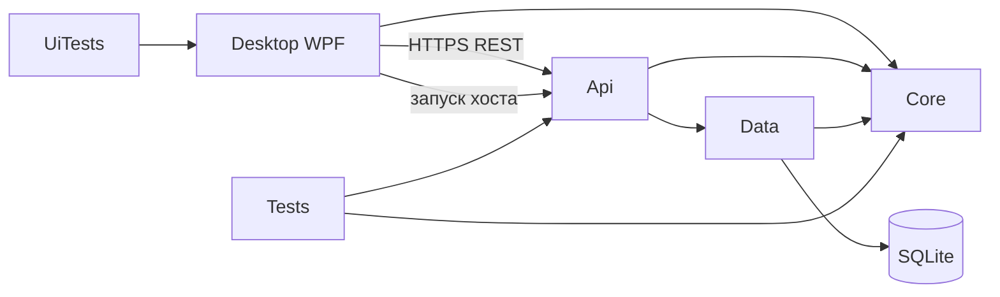
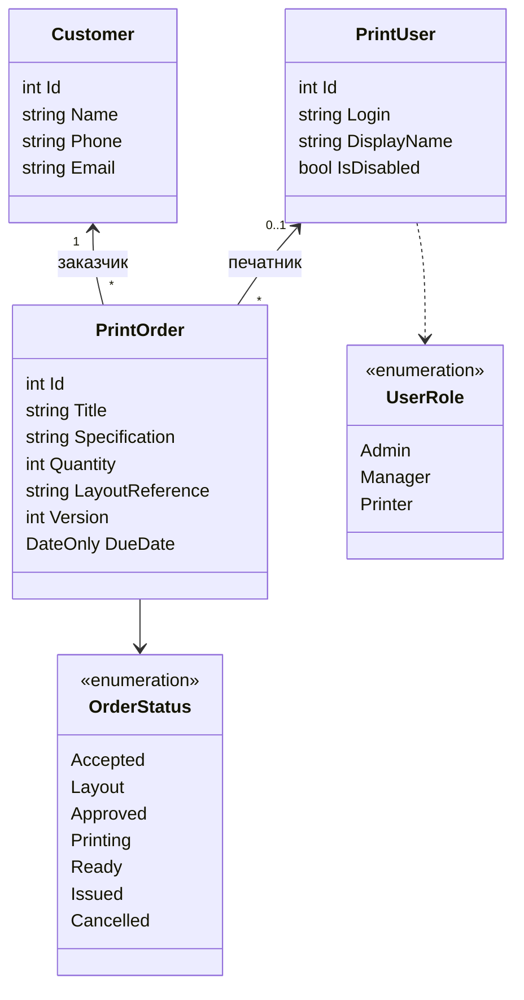

# Архитектура типографии

| Модуль | Назначение | Проектные зависимости |
|---|---|---|
| PrintingHouse.Core | Модель, правила, DTO, репозитории, CSV/JSON/XML | — |
| PrintingHouse.Data | EF Core, SQLite, миграции, выборки | Core |
| PrintingHouse.Api | REST, JWT, роли, обработка ошибок, Serilog | Core, Data |
| PrintingHouse.Desktop | WPF, модели представления, HTTP-клиент, встроенный запуск | Core, Api |
| PrintingHouse.Tests | Модульные и интеграционные сценарии xUnit | Core, Api |
| PrintingHouse.UiTests | Оконные сценарии FlaUI | Desktop.exe |

- Диаграмма модулей: [PNG](modules.png) и [draw.io](modules.drawio).
- Диаграмма классов: [PNG](classes.png), [draw.io](classes.drawio) и [файл Visual Studio](../PrintingHouse.Core/PrintClasses.cd).

| Интерфейс | Поставщик | Потребитель |
|---|---|---|
| `IOrderRepository` | `PrintStore` | Контроллер заказов, выгрузка |
| `ICustomerRepository` | `PrintStore` | Контроллер заказчиков, импорт |
| `IUserRepository` | `PrintStore` | Вход, контроллер сотрудников |
| `OrderRules`, `InputRules` | Core | Data и Desktop |
| HTTP JSON, CSV и XML | Api | Desktop и HTTP-клиенты |

При F5 WPF показывает окно входа и параллельно запускает Kestrel. Клиент сверяет отпечаток временного сертификата сервера. API применяет две миграции и при первом локальном запуске добавляет учебные заказы. При завершении работы окно закрывает встроенный сервер.
