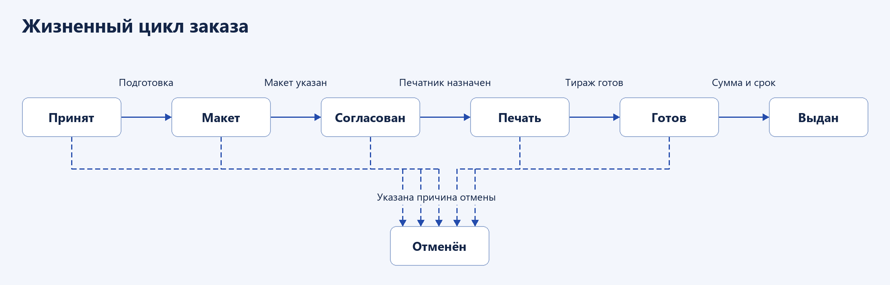

# Требования к проекту

Типография принимает заказы на буклеты, каталоги, визитки и другую печатную продукцию. Менеджер согласует макет, назначает печатника и выдаёт тираж. Администратор управляет доступом сотрудников.

## Функциональные требования

| ID | Требование |
|---|---|
| F01 | Вход по логину и паролю, показ роли и выход из сеанса. |
| F02 | Администратор просматривает сотрудников, создаёт учётные записи и разрешает или закрывает им вход. |
| F03 | Менеджер и администратор создают и редактируют заказы с указанием заказчика, продукции, параметров печати, тиража и срока выдачи. |
| F04 | При создании заказ получает статус «Принят». Смена выполняется по таблице ниже с контролем версии записи. |
| F05 | Менеджер и администратор назначают действующего печатника. |
| F06 | Печатник просматривает назначенные ему заказы и переводит свой тираж из «Печать» в «Готов». |
| F07 | Поиск по номеру, продукции, параметрам, макету, заказчику и телефону обновляется при вводе. |
| F08 | Выбор статуса сразу применяет фильтр. Поиск и фильтр действуют одновременно. |
| F09 | Менеджер и администратор ведут справочник заказчиков и импортируют CSV с диагностикой по строкам. |
| F10 | Менеджер и администратор выгружают заказы текущей выборки в CSV, JSON и XML. |
| F11 | Статистика показывает число всех, активных, выданных и отменённых заказов, суммы, средний срок выдачи и распределение по статусам. |
| F12 | Карточка показывает параметры печати, тираж, ссылку или имя файла макета, примечания, исполнителя, сумму и даты. |

## Нефункциональные требования

| ID | Требование |
|---|---|
| N01 | Клиент на WPF работает под Windows 10/11 x64. Основная сборка использует .NET 10. |
| N02 | Клиент общается с API по локальному HTTPS. Доступ определяется серверными ролями и назначением заказа. |
| N03 | SQLite хранит данные вне исходников. EF Core обновляет схему миграциями. |
| N04 | Даты выгрузки используют ISO 8601. Интерфейс принимает сумму с точкой или запятой и дату в описанных форматах. |
| N05 | При ошибках интерфейс сообщает, какое поле или строку CSV нужно исправить. API и Desktop ведут журналы. |
| N06 | Списки используют запросы без отслеживания, проекции полей и индексы по статусу и печатнику. Поиск поддерживает регистронезависимый ввод на кириллице. |

## Переходы заказа

[Исходник диаграммы состояний](lifecycle.drawio).

| Из | В | Условие |
|---|---|---|
| Принят | Макет | Заказ зарегистрирован. |
| Макет | Согласован | Указана ссылка или имя файла макета. |
| Согласован | Печать | Назначен действующий печатник. |
| Печать | Готов | Менеджер, администратор или назначенный печатник подтверждает готовность. |
| Готов | Выдан | Указаны положительная сумма и срок выдачи. |
| Принят, Макет, Согласован, Печать, Готов | Отменён | Менеджер или администратор указывает причину. |

Статусы «Выдан» и «Отменён» завершают заказ. Тираж составляет от 1 до 1 000 000 экземпляров. При одновременном редактировании устаревшая версия получает HTTP 409. Макет хранится как текстовая ссылка или имя файла.

## Пользовательские истории

1. Менеджер регистрирует тираж и его параметры, чтобы передать заказ в подготовку.
2. Менеджер прикрепляет к карточке ссылку на согласованный макет перед запуском в печать.
3. Печатник открывает свои заказы и отмечает изготовленный тираж как готовый.
4. Администратор добавляет сотрудника и закрывает вход для уволенного пользователя.
5. Менеджер выгружает готовые заказы в CSV, чтобы передать список на выдачу.
